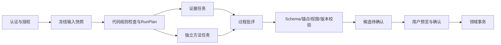

# 05 智能体工作流、并发与持久任务合同

状态：施工基线，2026-10-29。目标：任何运行都能说明输入、依赖、实际调用、结果与失败；Worker 崩溃、租约转移、模型超时和重复消息不会产生重复业务写入。

## ADR-001：单运行最多三个专责能力

锁定产品白皮书 2.1 第 7.1 节规定一次任务调用一个至三个角色。技术规范此前曾错误放宽职责上限，2026-10-30 原文与参考副本已勘误。现行合同统一为最多 3 个逻辑专责能力，四类能力总量不变。复杂链需要“澄清→证据→方法→批评”时，先完成澄清运行；用户确认简报后，启动带 `parent_run_id` 的新运行处理后续任务。上下游传准确版本引用，不能暗中跨运行自动确认简报。该裁决已由本轮主架构审查采纳。

模型调用次数与逻辑职责数量分别计费/限额。一个职责可在自己的工具循环内发多次模型请求，但受总调用、工具、token、费用和时间预算限制。三职责限制不能被“子角色”“合成角色”等名称绕过。合成/校验优先采用确定性代码；若使用模型生成呈现文案，按明确的模型调用预算记账，仍无新增业务权力。

## 分工与依赖图

| 用户任务 | 必要职责 | 并行与等待 | 完成产物 |
| --- | --- | --- | --- |
| 澄清课题 | clarification | 单职责；读取简报快照 | BriefClarification |
| 查证据 | evidence | 可并行多个只读检索，但共享总预算 | EvidenceBundle |
| 选择方法 | method，可选 evidence | 方法依赖事实时等待证据；否则可并行 | MethodProposal |
| 建议下一步 | evidence、critic，可选 method | 证据/独立方法并行，critic 等其必需依赖 | StageSuggestion |
| 历史解释 | evidence，可选 method | 只读历史快照，无直接可提交动作 | 解释与来源 |



图示是“下一步建议”的典型路径；查证据不必经过方法/批评。`RunPlan` 用 `tasks[]` 描述 `task_id`、role、`depends_on[]`、mandatory、input references、允许工具、预算、deadline。计划创建时验证 DAG 无环、职责数≤3、任务类型在白名单、依赖属于同 run、角色所需输入齐全。运行中若模型发现新问题，可以输出下一运行建议；P0 不动态扩出无限子图。

## 输入冻结与实际读取账本

`ContextSnapshot` 固定初始已确认页版、可选草稿快照、用户意图、模板/方法卡版本、授权范围、排除项、索引修订和预算。草稿内容必须物化成不可变快照，不能仅存“草稿 R8”的数字后又读取后来内容。

运行内 `search_evidence` 可能发现新片段。将每次已获授权的返回结果追加为 `RunReadRecord`：tool_call_id、对象版、锚点、内容哈希、安全摘录或可重建引用、实际 index_revision、访问纪元、读取时间、截断/无命中范围。输入快照不被回写。最终候选绑定初始快照加所有实际读取记录的 manifest_hash。重演使用保存的版本清单，不能对后来变化的索引重新搜索后声称复现了原运行。模型随机性、供应商变化仍会影响再次生成，报告应区别“读集可重建”和“输出完全一致”。

权限快照不是永久通行证。每次工具读、模型外发前和候选发布前都检查当前权限/资料外发策略；撤权后结束相关任务或安全降级。模型只接收这次必需的片段，无法访问整个文件系统、数据库或任意 URL。

## 三套状态机

**执行状态 `AgentRun.execution_status`**：`queued → running → completed | partial | failed | cancelled`。`completed` 表示必需任务和校验完成，业务仍未提交。等待人工确认不占 Worker/模型连接；由候选状态表达。产品稿中的 `context_scoped/planned/evidence_retrieved/critic_checked` 作为阶段事件和读模型进度，不承担全局锁。

**任务状态 `RunTask.status`**：`blocked → queued → running → succeeded | retry_wait | failed | cancelled`；从 retry_wait 回 queued 必须符合 attempts/deadline/budget。`blocked` 等待依赖；必需依赖失败时自身变 `cancelled`，写 `dependency_failed` 原因。非必需依赖失败可继续，但结果必须标缺失范围。

**候选状态 `Candidate.status`**：`pending → committed | rejected | expired`，一次性消费。原建议正文不可变；用户修订保存在预览/处置记录。Run 与 Candidate 独立：执行已 completed 仍可有 pending 候选；失败/局部运行只能发布经校验的局部信息，不能发布缺失必需依赖的阶段推进动作。兼容 UI 可派生 `await_user` 等显示状态，不能让页面显示枚举控制数据库事务。

## 任务认领、租约与 fencing token

持久任务表包含 `status`、`available_at`、`attempt_no`、`lease_owner`、`lease_until`、`fencing_token`、`input_hash`、`output_ref`、`last_error`。Worker claim 在一个短事务中选到期任务并条件更新；成功认领时 `attempt_no += 1`、`fencing_token += 1`。`lease_until` 用数据库统一时钟计算，默认租期/心跳是配置值，需故障实测后调整。

```text
claim(job_id):
  BEGIN short write transaction
  UPDATE jobs
    SET status=running, lease_owner=worker_id,
        lease_until=db_now+lease, fencing_token=fencing_token+1,
        attempt_no=attempt_no+1
    WHERE id=job_id AND available_at<=db_now
      AND (status=queued OR (status=running AND lease_until<db_now))
  require affected_rows == 1
  COMMIT and retain returned fencing_token

perform external work outside DB transaction

finalize(job_id, token, output):
  BEGIN short write transaction
  verify owner/token, lease valid, input hash and run still accepts results
  insert or conditionally publish result
  UPDATE job WHERE fencing_token=token AND owner=worker_id
  COMMIT
```

续租也必须条件更新 owner/token；旧 Worker 的迟到续租与 finalize 均失败。使用 `(job_id,fencing_token)` 作为每次尝试身份，不把 `worker_id` 当唯一写权。外部模型通常不支持真正的 exactly-once；租约过期后可能出现重复收费。必须记录每次 provider_request_id/attempt 的用量并计入预算，不能声称模型只调用一次。业务结果最终发布仍只有当前 token 能成功。

文件转换先写 attempt 专属临时目录，再生成不可变结果文件；只有当前 token 能登记“有效派生件”指针。旧 Worker 可能留下不可达临时文件，交由安全清理任务处理，不得覆盖新 Worker 的结果路径。

## 合成、晚到结果与取消

每个任务输出独立 `AgentResult(run_id,task_id,input_hash,attempt_no,fence)`。唯一发布键 `(run_id,task_id,input_hash)`；被废弃尝试的输出可记为 `discarded_late`，只保留安全诊断和用量。合成读取成功且 token 有效的任务结果，保留证据冲突和未知项。禁止把多个模型自由字典并成一个可变 `agent_outputs`。

在单一事务内关闭运行的 `accepting_results`、登记最终 result_manifest 与候选并写事件。之后晚到结果不能替换已发布候选、自动变成新候选或改变用户预览。重检新建 `run_id`，用 `supersedes_run_id` 关联。

取消运行先原子改 execution_status/accepting_results，再尽力取消网络和子进程。已发出的模型请求可能产生费用，记录实际结果但不发布候选。已提交的业务决定保持有效；撤销设计决定需要新的有审计命令。对必需步骤超时不得循环重试至无限；保存局部结果并进入 partial/failed。

## Outbox 与至少一次消费

业务事务写 `OutboxEvent`；Worker 轮询持久表，事件状态与认领租约独立。消费者以 `(event_id, consumer_name)` 唯一去重，在保存该消费者的数据库效果时同事务写 `consumer_receipt`。文件系统/外部转换无法加入同一 DB 事务时，采用不可变文件＋结果登记＋安全孤儿清理，允许重复计算但只认领一次有效结果。

必须测试两处崩溃：业务提交后通知前、派生文件完成后 receipt 前。前者可从 Outbox 重投；后者可凭确定性任务键/哈希重新登记，不能生成多个业务版本。P0 不依赖进程内广播保证任务不丢。未来引入消息代理，也继续按至少一次投递设计。

## 预算与 DeepSeek 适配

`ModelAdapter` 提供统一输入/输出，独立实现 Fake 与 DeepSeek。单运行配置包含 max_specialists=3、max_model_calls、max_tool_calls、max_input_tokens、max_output_tokens、max_cost、deadline、并发 semaphore。起始预算遵守现有技术规范的 6 次只读工具、12 片段、30 节点/2 跳；模型调用和费用另明确配置。账户并发限制与项目预算取更小者。

并行任务不得各自消耗一整份预算：预算由运行服务原子预留，每次供应商调用结束按实际用量结算。未知用量先保留估算/标记待核，不将其记成零。429、暂时网络错误与可恢复 5xx 有界退避；401、402、无权限、无效 Schema/锚点不盲重试。结构化输出最多一次受控纠正后仍失败，则结束该任务。供应商 JSON/工具 strict 模式不是本地验证的替代品。

## 自主实现空间与交付门槛

实现者可在纯 Python DAG 调度与经过验证的 LangGraph 之间选择；默认纯代码更容易对齐上述数据库状态。采用 LangGraph 前先用同一组竞态和恢复测试证明 checkpoint 不会绕过领域提交或租约规则。无需为了名称引入多进程模型服务或复杂总线。完成后给出至少一份含并发任务、失败重试、撤权和人工确认的运行账本样例；FakeProvider 的通过仅证明控制逻辑，真实模型能力单独评测。

## 主动建议频率与触发合同（T06 → T08，R02）

偏好属于 `(project_id, actor_id)`，只配置本人授权范围，含 mode、scope、cooldown_seconds、digest_interval_seconds、revision、next_due_at。mode 为 off/manual/event/digest，默认 manual。off/manual 都不自动创建运行；直接请求仍按 run.create 和预算判断。配置不是决策授权，所有候选继续等待用户确认。偏好 CAS 只递增个人设置修订，不改变设计 ProjectRevision。

T06 持久化策略、调度与触发记录；T08 负责运行创建前重查发起者当前会话以外的账号有效性、成员/动作权、范围、资料外发政策与预算，再物化输入快照。后台调度以最初明确启用策略的 actor 为受限主体，不使用全局管理员替代；账号禁用、撤权或策略关闭时不得开始新的自动外发。交互登录会话到期不自行授予或扩大后台权限；恢复登录也不自动补跑历史积压。

事件模式仅消费白名单业务事件（页正式版创建、原件版本登记、测试记录确认）；run/candidate 自身事件不得循环触发。digest 使用 UTC 时间窗，周期为可配置正数，并设最小间隔；不在轮询迟到时补跑每一个历史时间窗。输入范围在偏好中明确保存，不能读取共享“当前页”或另一个用户的界面选择。

触发唯一键为 `(project_id, actor_id, preference_revision, trigger_kind, trigger_key)`；event 的 key 是源 event_id，digest 的 key 是 UTC 时间窗。一个短事务内检查策略修订/冷却/当前未完成自动任务，写触发记录、冷却截止、Job 与 Outbox。重投同一事件不能重复建 Job；并发触发最多赢一次，冷却期间记录 coalesced/suppressed，不积累无界队列。运行真正在 T08 启动时再次检查策略仍启用且版本/范围仍合适；过时 Job 标 superseded/cancelled 而不外发。配置变更不自动取消已经提交的设计决定。

T06 验证 off/manual 零自动 run、事件去重、定时窗口/冷却的并发竞态与重启恢复；T08 验证排队期间撤权/关闭策略无模型调用。权限/存储完整性告警走独立确定性通道，不受设计建议频率控制，不调用模型代替安全通知。


### 自动运行期间更改偏好

自动 run 明确保存 origin=policy、preference_revision；手动 run 为 origin=manual。每次工具读、模型外发、候选发布前都重查自动运行绑定的偏好修订和当前授权。偏好修改事务使旧修订未结束自动 run 停止接受结果并转取消；保守地对任何偏好修订变化取消旧自动 run，避免运行中继续使用过大的旧范围。已经发送的请求尽力取消，晚到仅保留安全诊断与实际用量，不发布候选。后续按新策略重新排队并冻结新输入。

T08 必须用可控 Provider 验证：第一轮调用完成后关闭策略或缩小范围，第二轮工具/模型调用被拦截、运行不再发布候选。手动运行不跟随自动建议开关取消，仍受其自身当前授权与预算控制；已提交设计决定不回滚。

