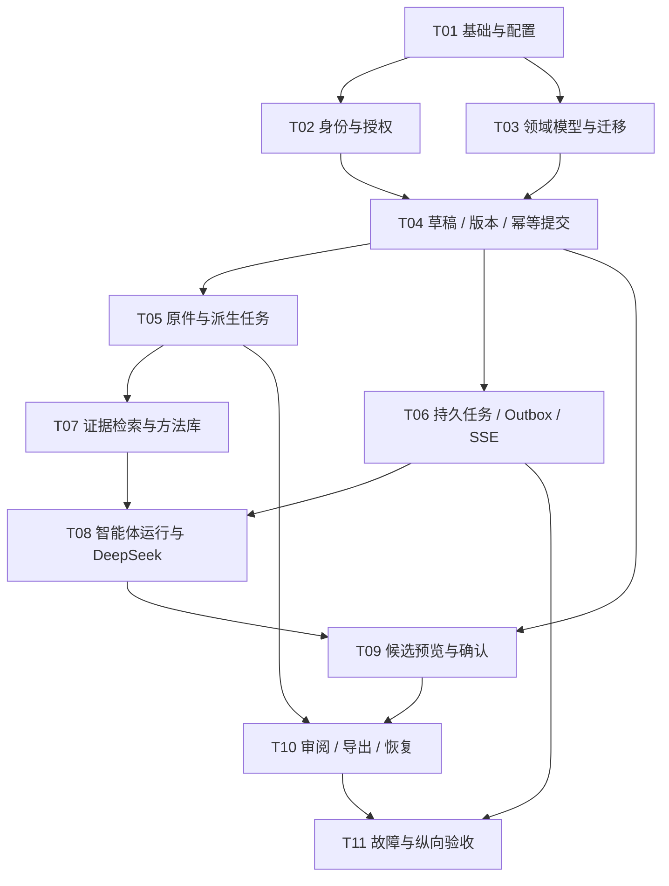

# 开发路线与并行交接

版本：1.1｜2026-10-30。面向 Grok 主控、开发、审查和集成代理。目标是交付可运行、可审计的思诺 P0 后端；UI 留给后续专门工作。

## 1 完成目标与依据优先级

以一个有授权的工业设计项目跑通：建项目与平行页→保存资料原件→提取有定位的证据→按任务调用专责能力→生成候选→具权者确认→新建阶段空白页→查看旧版本并创建新分支→授权审阅→导出及恢复。每一步都必须有真实 API、数据库状态与验收证据。

依据按“用户当前要求→锁定产品白皮书 2.1→本施工包的已裁决合同→技术实施规范 1.1→旧 D/E 代码参考”排序。旧代码仅用于理解与局部借鉴。发现冲突时记录具体条款、受影响任务和处理决定，继续没有依赖该冲突的工作。

**已裁决差异：** 产品 2.1 的单任务调用上限优先。系统有四种可选职责，单个 `AgentRun` 最多使用三种。需要任务澄清、证据、方法、过程批评完整四职责链时，先运行澄清并取得用户确认，再创建带 `parent_run_id` 的后续运行；后续运行重新装配快照与当前权限。技术规范 1.1 的旧职责上限已完成受控勘误；不得使用归档旧稿扩大运行上限。

完成范围是 P0 后端、工作进程、模型适配器、可重放运行账本、迁移、测试、运维脚本与 API 交接。Swagger/OpenAPI、CLI 与测试客户端用于验收；本轮不实现产品页面、动效或视觉设计。

## 2 施工顺序与依赖

依赖完成是接口和验收证据已合入集成分支，不能仅凭上游口头说明。T02 与 T03 可并行；T05 与 T06 可并行；T07 可在 T05 稳定后开发；T08 可先用冻结接口与 fake provider 编写独立测试，但集成验证需 T06、T07。T11 的故障夹具与验收脚本可提前准备，最终判定等待整条链。

## 3 模块所有权

| 施工角色 | 主要写入范围 | 负责产物 | 必须由集成 owner 协调的文件 |
| --- | --- | --- | --- |
| 集成 owner | 项目入口、依赖、共享配置、迁移次序、契约注册、工作池 | 可启动主干、稳定接口、发布门禁 | `pyproject.toml`、锁文件、`src/sinuo/api/app.py`、Alembic revisions、公共 schema |
| 身份 / 领域开发 | 已认领的 `domain/`、`application/`、对应 API 和测试文件 | ACL、领域不变量、事务、幂等 | 通用 principal、错误码、事务 UnitOfWork |
| 资产 / Worker 开发 | 资产基础设施、`workers/`、对应测试 | 原件、派生件、租约、Outbox | 共享迁移、事件 schema、存储键规则 |
| 智能体开发 | `agents/`、模型适配器与运行仓储、对应测试 | DAG、工具网关、候选、Provider | 共享工具 schema、权限投影、运行状态枚举 |
| 验收 / 审查 | `tests/` 已认领子路径、审查记录 | 反例、故障测试、接口与恢复检查 | 修改被测实现需退回原 owner 或重新认领 |

认领前将精确文件或子目录记入任务卡。目录只是初始分区；API 和迁移的具体文件由集成 owner 一次分配。同一时段只允许一位代理编辑一个文件。若运行环境支持 Git worktree，可每任务独立分支；若共享目录，则严格按文件所有权并行。没有子代理工具时按同一依赖顺序轮换角色，记录“单代理顺序执行”。

现有骨架将基础 ORM 模型放在 `src/sinuo/infrastructure/models.py`，该文件在 T03 扩展时由集成 owner 管理。下游可以新建自己拥有的模型模块并提交明确迁移提案，由集成 owner 注册和合入。任务卡中的路径是初始分配边界；主控可在认领时细分或改名，但须同步消费者和验收入口。

## 4 接口交接门槛

上游交接必须含：接口/schema 版本、实现位置、运行命令、成功与失败响应、权限动作、事务范围、已执行测试、一个真实夹具、已知限制。下游先运行上游提供的最小验证命令，再开始依赖开发。

接口变更可自主提出并实现，但需先在任务卡记录消费者与兼容策略。共享 schema 和迁移由集成 owner 合并；两个代理不能各自添加同名状态或不同含义的错误码。适配旧接口优先于同时大改全部模块；若重构降低复杂度，可用 ADR 说明成本、迁移和验证。

T05 与 T06 共享的派生任务接口在开始并行前冻结。T05 负责登记原件与派生请求，可用确定性消费者测试本模块；T06 负责持久认领、重试与投递。两者各自交接后再跑 G2 联合故障验收，不能把使用 fake consumer 的结果写成生产 Worker 已验证。T08 的 FakeProvider 同理：可提前验证编排规则，真实持久链必须等待 T06、T07。

## 5 每个里程碑的门禁

| 门禁 | 进入条件 | 完成证据 |
| --- | --- | --- |
| G0 可启动 | T01 | 干净环境安装、health/readiness、迁移到 head、测试命令可运行 |
| G1 写入可信 | T02–T04 | 越权拒绝、CAS 冲突、幂等重放、事务回滚、历史只读 |
| G2 资料与任务可靠 | T05–T07 | 原件哈希、失败预览回退、重复投递、租约过期隔离、撤权后的流/搜索隔离 |
| G3 AI 候选可信 | T08–T09 | fake provider 全流程、预算停止、来源校验、候选一次消费、预览哈希绑定 |
| G4 可交接 | T10–T11 | 纵向场景、并发故障、备份恢复、OpenAPI、限制清单和 UI 数据合同 |

门禁失败只阻断依赖它的工作。已经授权的调试、测试、局部重构与依赖修补可继续，不需反复等待用户许可。最终交付必须同时提供通过项、未通过项及复现方法。

## 当前开工归属

Codex负责架构/文档与验收监督，Grok主控负责具体代码及唯一代码集成。当前没有初始Git commit；身份或worktree条件不足时按施工53的哈希快照/单文件owner流程施工，不虚构Git身份。首波T02/T03先冻结共享合同，再按不重叠文件并行。完整开工步骤见53，不能仅凭提示词假称工具能力。
